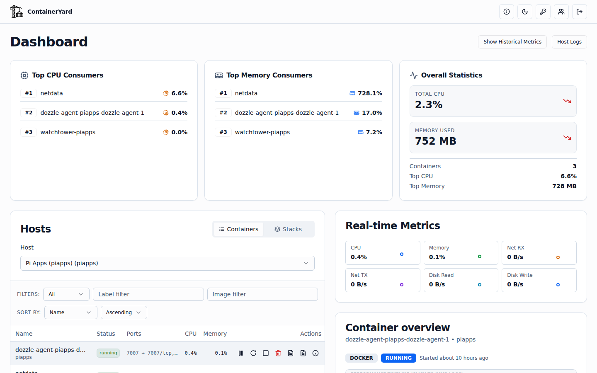
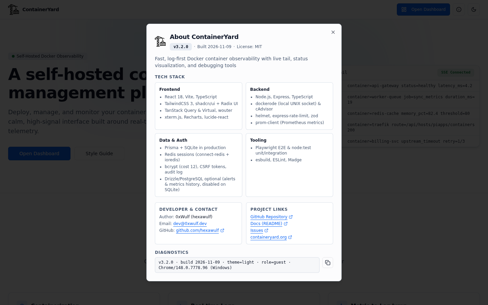
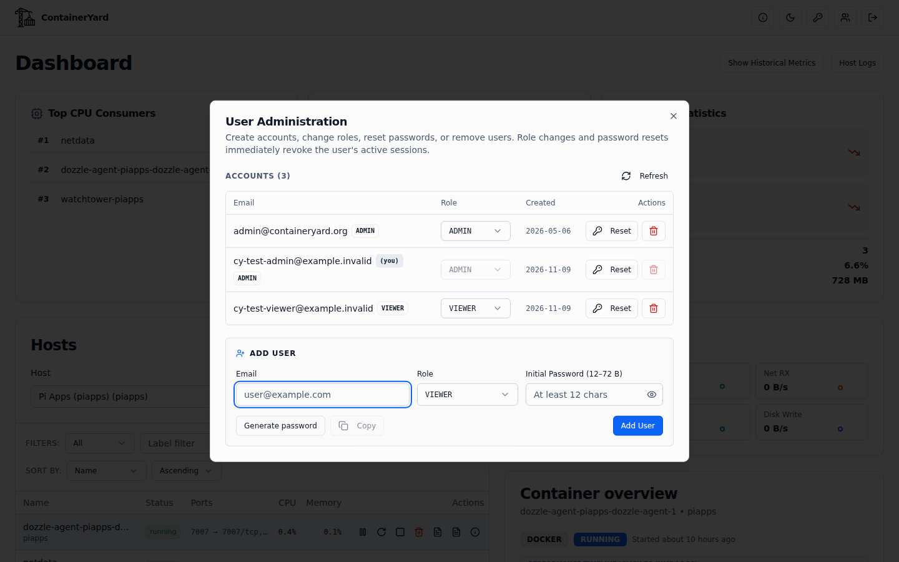

[](https://containeryard.org)
[](https://github.com/hexawulf/ContainerYard)

# ContainerYard 4.0 🐳

> A complete Docker stack monitoring platform with log analysis, alerting, and historical trends

[](https://github.com/hexawulf/ContainerYard/releases/tag/v4.0.2)
[](https://hub.docker.com/r/0xwulf/containeryard)

**ContainerYard 4.0** ships official multi-arch Docker images (`0xwulf/containeryard` for `linux/amd64` and `linux/arm64`) with a hardened non-root runtime, bundled Redis session store, automated Prisma schema sync + bootstrap seeding at container start, environment-driven host log paths, and GitHub Actions CI/CD with SBOM and provenance attestations. **3.2** introduced a light-by-default theme system with a persistent light/dark mode toggle on every page, zero flash on load, a full WCAG AA UI refresh across both themes, and a unified top-right header action bar (About modal with build metadata & diagnostics, self-service password change, ADMIN user management, and instant `sessionVersion` session revocation). **3.1** added per-container lifecycle actions, an audit log, working Log Moment bookmarks, restored CSRF enforcement, and SSRF-safe webhooks. **3.0** brought multi-host monitoring (Docker + cAdvisor-only hosts) and SQLite as a first-class database. See [What's new in 4.0](#-whats-new-in-40), [3.2](#-whats-new-in-32), [3.1](#-whats-new-in-31), and [3.0](#-whats-new-in-30).

ContainerYard is a comprehensive Docker observability platform that goes beyond simple log viewing. It provides Docker Compose stack management, proactive alerting, historical metrics analysis, and real-time log streaming—all in one sleek, developer-friendly interface. Built with React 18 and Express, it bridges the gap between lightweight viewers and enterprise monitoring solutions.




## ✨ Features

### 🎯 Stack Management (Phase 1)
- **Docker Compose Stack Detection** - Automatically groups containers by compose project
- **Stack Health Indicators** - Visual status badges (healthy/unhealthy/partial/unknown)
- **Bulk Stack Operations** - Start, stop, or restart entire stacks (ADMIN, with confirmation)
- **Container Actions** - Start, stop, restart, pause, unpause or remove a single container from the table (ADMIN, audited)
- **Stack-Level Metrics** - Aggregated stats for all containers in a stack
- **Standalone Container View** - Separate display for non-compose containers

### 📢 Proactive Alerting (Phase 1)
- **Alert Rules Engine** - Define CPU, memory, status, and log pattern alerts
- **Duration-Based Triggers** - Alerts fire only when conditions persist (e.g., CPU > 80% for 5 minutes)
- **Multiple Notification Channels** - Webhook, email, and browser notifications
- **Alert History & Acknowledgment** - Track triggered alerts with audit trail
- **Smart Debouncing** - Prevents notification spam with 5-minute cooldown
- **Background Monitoring** - Continuous 30-second health checks
- **Container Filtering** - Target specific containers by name, image, or labels

### 📊 Historical Trends (Phase 1)
- **Hourly Metrics Aggregation** - Automatic collection and storage of container metrics
- **90-Day Retention** - Long-term trend analysis with configurable retention
- **Top Resource Consumers** - Identify CPU and memory hogs over time
- **Metrics Summary API** - Query historical data with flexible time ranges
- **Avg/Max Statistics** - Track both average and peak resource usage
- **Per-Container History** - Detailed historical charts for capacity planning

### Core Features
- 🔴 **Real-time Container Monitoring** - Live status updates, metrics, and health checks
- 📜 **Advanced Log Streaming** - Virtual scrolling for performance with large log datasets
- 🔍 **Powerful Search & Filtering** - Regex support, log level filtering, and custom DSL queries
- 💻 **Integrated Terminal** - Web-based shell access for container debugging
- ⌨️ **Keyboard Shortcuts** - Navigate efficiently with keyboard-driven controls
- ☀️ **Light/Dark Mode Toggle** - Light mode by default with a persistent per-browser toggle on every page, zero flash on load, and WCAG AA contrast tuned for log readability in both themes
- 👥 **User Administration & Session Revocation** - Self-service password change, ADMIN user management modal (create users, assign `ADMIN`/`VIEWER` roles, reset passwords, delete users), and instant `sessionVersion`-based revocation across active sessions

### Advanced Features
- 🎨 **Multi-Container Log Interleaving** - Stream and compare logs from up to 3 containers simultaneously
- 🔖 **Log Moments Bookmarks** - Save timestamped log moments with notes and shareable deep-links
- 📊 **JSON Field Detection** - Auto-parse structured logs with interactive field chips
- 🔎 **Query DSL** - Advanced query syntax: `level:warn..error`, `service:auth`, `-"exclude"`
- 📈 **Timeline Spike Analysis** - Clickable metric spikes auto-scope logs to relevant time windows
- 🔥 **Log Rate Heatmap** - Visualize log bursts with Z-score detection and auto-filtering
- 🔄 **Restart Comparison** - Before/after restart analysis with error pattern detection
- 💾 **Saved Searches** - Persist search queries with PostgreSQL for quick reuse
- 🌐 **Environment Viewer** - Search, filter, and bulk export container environment variables

## 🆕 What's New in 4.0

### Official Multi-Arch Docker Image (`0xwulf/containeryard`) & Release Pipeline
- **Multi-arch Docker Hub image (`linux/amd64`, `linux/arm64`):** Built from `node:22-bookworm-slim` (digest-pinned) with a `$BUILDPLATFORM` bundle stage and target-arch native dependency stage (`bcrypt` + Prisma engines). Runs as non-root `node` (`uid 1000`) under `tini` PID 1 with a built-in Node `fetch` `HEALTHCHECK` against `/health`, OCI labels, SBOM, and SLSA provenance attestations.
- **Zero-touch container entrypoint (`docker/entrypoint.sh`):** Validates required environment variables on startup (without printing secret values), creates the SQLite `/data` directory, runs `prisma db push --skip-generate`, seeds the bootstrap `ADMIN` user when the `User` table is empty, and execs `node dist/index.js`. Set `CY_SKIP_DB_PUSH=1` to skip schema sync on boot.
- **Hardened `docker-compose.yml` + `deploy/hostlogs/` overlay:** Bundles `redis:7-alpine` (digest-pinned, AOF persistence, internal network only), mounts `cy-data:/data` and `/var/run/docker.sock`, drops all Linux capabilities (`cap_drop: [ALL]`), enforces `read_only: true` rootfs + `no-new-privileges:true`, binds to `127.0.0.1:5008`, and sets `com.centurylinklabs.watchtower.enable=false`.
- **Environment-driven host log & socket paths:** `HOSTLOG_NGINX_DIR`, `HOSTLOG_NGINX_ACCESS_FILE`, `HOSTLOG_NGINX_ERROR_FILE`, `PM2_LOG_DIR`, `PM2_APP_NAME`, `HOSTLOGS_LOCAL_HOST`, and `DOCKER_HOST` allow containerized deployments to read bind-mounted host logs (`/host/nginx:ro`, `/host/pm2:ro`) while degrading cleanly to "not available" when absent.
- **Automated CI/CD & ops scripts:** `.github/workflows/ci.yml` runs typecheck, lint, unit tests, production build, and the full integration test suite against the built Docker Compose stack; `.github/workflows/release.yml` verifies tag == `package.json` version, runs CI on the tag, and publishes `:4.0.0`, `:4.0`, and `:latest`. Operations scripts (`scripts/docker-deploy.sh`) provide `--dry-run` previews and SQLite volume backups.

## 🆕 What's New in 3.2

### Header action bar, About modal, self-service password change & ADMIN user management
- **Unified top-right header action row (`Navbar`):** Every page now renders a consistent icon action row in exact left-to-right order: `[Open Dashboard (off /dashboard)] · (i) About · Theme · Change password · Users (ADMIN only) · Logout`. Moved `Logout` out of the Dashboard sub-header and moved developer/repository/documentation links out of the footer into the `About` modal so the footer remains minimal (`Built for self-hosted container observability.` + `Style Guide`).
- **About modal (`AboutModal`):** Accessible from every route (logged in or logged out). Displays the ContainerYard logo, tagline, build-time version (`v{__APP_VERSION__}`) and date (`__BUILD_DATE__` injected via `vite.config.ts`), runtime user/role badge when signed in, verified 4-group tech stack (`Frontend`, `Backend`, `Data & Auth`, `Tooling`), developer contact (`0xWulf` / `hexawulf`, `mailto:dev@0xwulf.dev`), project links (GitHub repo, README docs, Issues, `containeryard.org`, MIT license), and a one-click copyable diagnostics string.
- **Self-service password change (`ChangePasswordModal` & `POST /api/auth/change-password`):** Any authenticated user (`ADMIN` or `VIEWER`) can change their own password. Enforces `12`–`72` UTF-8 bytes (`Buffer.byteLength` cap matching bcrypt's 72-byte limit) and inequality with the current password on both client and server, hashes with `bcrypt` cost 12, increments `User.sessionVersion`, and regenerates the caller's session so the caller stays signed in while every other session for that user is immediately revoked.
- **ADMIN user administration (`UsersModal` & `/api/users`):** `ADMIN` users get a dedicated header button opening a responsive User Administration modal to list accounts, create users (with a CSPRNG password generator and copy button), switch roles (`ADMIN` / `VIEWER`), reset passwords, and delete users (cascading `LogBookmark` and `SavedSearch` rows in a single `prisma.$transaction`). Server guards prevent self-deletion or self-demotion (`403`) and deleting or demoting the last remaining `ADMIN` (`409`).
- **DB-backed session revocation (`User.sessionVersion`):** Added `sessionVersion Int @default(0)` to `User` in `server/prisma/schema.prisma`. `requireAuth` and `requireRole` verify the user record and `sessionVersion` on every request, destroying stale sessions (`401`) and syncing role changes immediately. All mutations are recorded in `AuditLog` (`auth.password_change`, `user.create`, `user.role_change`, `user.password_reset`, `user.delete`).

| About Modal | User Administration Modal (ADMIN) |
|---|---|
|  |  |

### 3.2.0: light-by-default theme toggle & UI refresh
- **Light-by-default theme system (`containeryard-theme`):** Light mode is now the default across the app, paired with a persistent `ThemeToggle` (`Sun`/`Moon`) in the navbar on every route (Landing, Login, Dashboard, Host Logs, Style Guide, 404). An inline `<head>` script sets `<html class="light|dark">`, `colorScheme`, and `<meta name="theme-color">` before first paint so there is zero flash of the wrong theme on load. Stored `"dark"` resolves to dark; `"light"`, missing, invalid, or legacy `"system"` values resolve to light
- **WCAG AA token & UI refresh:** Retuned `:root` (light) and `.dark` CSS tokens (`≥ 4.5:1` contrast for body/muted text, badges, and log levels), added semantic status variables (`--status-running`, `--status-warning`, `--status-danger`, `--status-info`, `--status-neutral`) and theme-aware `.log-error`/`.log-warn`/`.log-info`/`.log-debug`/`.log-fatal` classes, replaced hardcoded colors across charts, monitoring widgets, stack cards, and log viewers, and kept the interactive `xterm.js` terminal canvas dark (`#0d1117`) in both themes inside a clean card frame
- **Responsive layout & repo hygiene:** Fixed mobile horizontal overflow down to `375px` viewports across Dashboard and Host Logs, archived stale root markdown notes into `docs/_archive/`, and added unit (`server/tests/unit/theme.test.ts`) and Playwright E2E (`e2e/theme.spec.ts`) tests

## 🆕 What's New in 3.1

### 3.1.2: security, ops and maintenance
- **Dependency security updates:** `npm audit fix` cleared the high-severity advisories in `body-parser`, `cookie`, `nanoid`, `postcss`, `@grpc/grpc-js` and `esbuild`, among others, and an npm override forces `qs` ≥ 6.16.2 (it was bundled in Express). Two advisories remain, each needing a major upgrade, and are planned for 3.2: **zod 4** (request bodies are capped at 1 MB, which limits exposure) and **Prisma 7** (`deepmerge-ts`, only reached by the Prisma CLI config loader, never at runtime)
- **38 unused packages removed**, including `csurf`, `passport`, `connect-pg-simple`, `framer-motion`, unused Radix components, `supertest` and the Jest types
- **One PM2 definition:** `ecosystem.config.cjs` now matches production (`containeryard-api`, fork, 1 instance). Three conflicting configs are gone; two of them used cluster mode with `instances: max`, which would break the per-process rate limiters, live streams and workers. `scripts/deploy-static.sh` is the deploy path (DB backup → `npm ci` → schema push → build → `pm2 startOrReload` → health check; `--dry-run` supported)
- **Host logs are ADMIN-only** (nginx access logs contain visitor IPs), matching the download route. The buttons are hidden for viewers
- **Tests:** the dead Jest specs are replaced by `npm run test:integration`, a test suite run against a live instance (auth/CSRF, logs, SSE, host logs, bookmarks, saved searches, audit, opt-in container actions on `cy-test*` containers only). `npm test` runs the unit tests, and `check:tests` passes again
- **Docs:** Quick Start and Configuration rewritten to match `env.ts` (the old `PROVIDER` modes are gone); new env, hosts and database tables; `.env.example` rewritten. The advice to expose `dockerd` on TCP 2375 is now a warning against it
- **Prisma CLI config** moved to `prisma.config.ts` (the `package.json#prisma` key is deprecated in Prisma 7); the stale `prisma/schema.prisma` stub was removed

### 3.1.1: log viewer fixes
- **Live tail in the container logs drawer works.** It was connecting to the snapshot route (`/logs?follow=true`) instead of `/logs/stream`, so "Go Live" failed instantly. Pausing no longer reconnects and replays lines
- **Log download works.** The drawer sent `id=`, but the server expects `containerId=`, so every download returned 400
- **The "Since" filter works.** `3600s` was parsed as `NaN`, so Docker ignored it; durations (`90s`, `15m`, `2h`, `1d`), seconds and ISO timestamps are now accepted
- **The Host Logs page works.** It used to read files by exec'ing `tail` in a `cadvisor` container that did not exist on the local host. It now reads them directly, resolves the current pm2 log files at runtime (`containeryard-api-out-N.log`), shows real "available" flags, and supports live follow (`?follow=1`, SSE). The dead Grafana/Prometheus entries were removed. Host logs are local-only (`HOSTLOGS_LOCAL_HOST`, default `local`); remote hosts now show an explanation instead of the local host's files under the wrong name
- **The header "Host Logs" button** pointed at `/host-logs` (404); it now opens the selected host's logs
- **Saved searches in the log drawer work.** Like bookmarks, the UI called `/api/saved-searches`, but no server route existed. It's now stored with Prisma, per user
- **Refreshing or deep-linking a signed-in page no longer bounces to the login page.** AuthGate redirected before the session check finished, and the login page queried `/api/auth/me/login` (404)

Upgrade: `npm run db:push:prisma` (adds the `SavedSearch` table), then build and restart.


### Container Actions
- **Per-container lifecycle buttons** in the container table: start, stop, restart, pause, unpause and remove. Which buttons appear depends on the container's state; stop, restart, pause and remove ask for confirmation first
- **API:** `POST /api/hosts/:hostId/containers/:containerId/actions` with `{ "action": "pause" }`. Accepts a container ID or name. "Already started" or "already stopped" is a no-op (`noop: true`); conflicts such as pausing a paused container return 409
- **ADMIN only**, rate-limited to 30 actions/min, and only on Docker hosts (cAdvisor-only hosts stay read-only). Stack bulk actions now need ADMIN too, and stop/restart ask for confirmation

### Audit Log
- New `AuditLog` table (Prisma, works on **SQLite and PostgreSQL**) records every container and stack action, plus logins. Successful, failed and **denied** attempts are all logged with user, host, target and IP
- `GET /api/audit` (ADMIN) lists entries newest first. Entries older than `AUDIT_RETENTION_DAYS` (default 180) are pruned daily

### Log Moment Bookmarks (now actually working)
- The bookmark UI has existed since Oct 2025, but the server never had `/api/bookmarks`, so every save failed with a 404. The routes now exist, backed by Prisma (SQLite + PostgreSQL), with bookmarks kept **per user**

### Security
- **CSRF enforcement restored.** It was removed in Nov 2025 together with `csurf`, which left every POST/PATCH/DELETE route unprotected. Mutating `/api` requests now need the session's `x-csrf-token`, and the client refreshes a stale token once automatically
- **SSRF protection for webhook channels.** Only http(s) is allowed; private, loopback, link-local, metadata (169.254.169.254) and multicast targets are blocked. Every resolved address is checked when the connection is made, so DNS rebinding is blocked too. Redirects are never followed, and requests time out after 10 s. For LAN targets (ntfy, Gotify, …) set `WEBHOOK_ALLOW_PRIVATE=true` or list hosts in `WEBHOOK_ALLOWED_HOSTS`
- Creating, editing and deleting alert rules and channels now needs ADMIN

### Fixes
- **Docker log demultiplexing:** on live streams, frames split across chunk boundaries were dropped or shown with raw header bytes, and multi-byte UTF-8 split across frames was garbled. Replaced with a stateful demuxer
- **E2E screenshots:** the PR #2 images all showed the "Startup Error" screen because the spec mocked every API call with `{}`. The spec now mocks each endpoint properly, fails if the error screen appears, and the images were regenerated
- Notification sending is no longer duplicated between the alert worker and the alert routes

### Upgrading from 3.0
```bash
git pull && npm install
npm run db:push:prisma      # adds the AuditLog and LogBookmark tables (non-destructive)
npm run build && pm2 restart containeryard-api
```

## 🆕 What's New in 3.0

> Version note: `v2.0.0` was the November 2025 Phase 1 release. A November 2026 PR (#2) was mistakenly labelled "v2.0.0" a second time, so that release ships as **v3.0.0**.

### Monitoring
- **Metric-to-Log Quick Jump**: click a metric point to open the logs for that time window
- **Multi-host support**: host-aware Docker clients, a host summary endpoint, and `CADVISOR_ONLY` hosts (e.g. `edge-01`) with container overviews from cAdvisor
- **NAS and remote host fixes**: container lists and log retrieval work on remote hosts again
- **Logs and inspect**: unit formatting fixes, numeric CPU/memory values, and a restored `/api/containers` route

### Data layer
- **SQLite is a first-class database mode** (`DATABASE_URL=file:...`); PostgreSQL is still supported, and the Neon WebSocket is turned off under SQLite. Note: alert rules, the alert worker and historical metrics aggregation still require PostgreSQL; under SQLite they are disabled and restart tracking is in-memory only

### Security and reliability
- **Hardened session cookies**, login rate limiting, and auth lockdown on protected routes (the 3.0 notes also listed CSRF enforcement, but it wasn't actually active; 3.1 restores it)
- **Health endpoints** (`/health`, `/api/health`) and a `runtime-config` endpoint that keeps the client from crashing at boot
- **Crash fixes**: null-safe `.map` guards across the client, plus a fix for the prom-client `PerformanceObserver` error
- **Clean TypeScript build** (all errors resolved), about 2,000 lines of dead code removed, and new tests

### Web and SEO
- Unique page titles (`react-helmet-async`), updated meta tags, sitemap and robots.txt for `containeryard.org`, and proper 404s for missing sitemap/robots paths
- Landing page: GitHub icon and a developer contact button; refreshed e2e screenshots

### Ops
- Corrected the PM2 target in the restart script; dependency updates

## 🚀 Quick Start

### Run with Docker (Recommended)

ContainerYard is published to Docker Hub as **[`0xwulf/containeryard`](https://hub.docker.com/r/0xwulf/containeryard)** (`linux/amd64` and `linux/arm64`).

```bash
cp .env.example .env && nano .env     # Set SESSION_SECRET, REDIS_PASSWORD, ADMIN_*, ALLOWED_ORIGINS, CADVISOR_URLs
docker compose pull
docker compose up -d
```

The app and UI listen on **`127.0.0.1:5008`** by default (`CY_BIND=127.0.0.1`, `CY_PORT=5008`). Point your TLS reverse proxy (Nginx, Caddy, Traefik) at `http://127.0.0.1:5008` with `X-Forwarded-Proto: https` (session cookies are `Secure`, and Express runs with `trust proxy = 1`).

To also mount local host Nginx and PM2 logs read-only for the ADMIN **Host Logs** page:
```bash
docker compose -f docker-compose.yml -f deploy/hostlogs/docker-compose.hostlogs.yml up -d
```

#### Volumes & Backup / Restore
- **`cy-data` (`/data/app.db`):** SQLite database storing users (`sessionVersion`), `AuditLog`, `LogBookmark`, and `SavedSearch`.
- **`cy-redis` (`/data`):** Redis AOF storage for active login sessions.
- **Backup DB:**
  ```bash
  mkdir -p ~/backups/containeryard
  docker run --rm -v containeryard_cy-data:/data:ro -v "$HOME/backups/containeryard:/backup" \
    --entrypoint /bin/cp 0xwulf/containeryard:latest -a /data/app.db "/backup/app.db.bak-$(date +%Y%m%d-%H%M%S)"
  ```
- **Deploy / Upgrade:** `scripts/docker-deploy.sh 5.0.0 [--dry-run]` pulls the tag, backs up `cy-data`, runs `docker compose up -d`, waits for the container healthcheck, and verifies `/health`.

### Bare-Metal / Development Installation

```bash
git clone git@github.com:hexawulf/ContainerYard.git
cd ContainerYard
npm ci                               # also runs `prisma generate`

cp .env.example .env
nano .env                            # fill in the required variables (see below)

npm run db:push:prisma               # create the SQLite/PostgreSQL tables (users, audit log, bookmarks, saved searches)
node server/prisma/seed.js           # create the first ADMIN from ADMIN_EMAIL / ADMIN_PASSWORD (no-op if users exist)

npm run build
npm start                            # or legacy PM2: pm2 startOrReload ecosystem.config.cjs && pm2 save
```

For development, `npm run dev` serves port `5008` with Vite hot reload.

## ⚙️ Configuration

### Environment Variables

The server (`server/src/config/env.ts`) and container entrypoint (`docker/entrypoint.sh`) validate these at startup and exit with a clear error if any required variable is missing.

| Variable | Required | Default | Example / Purpose |
|---|---|---|---|
| `SESSION_SECRET` | **Yes** | — | Session signing secret, **≥ 32 chars** (`openssl rand -hex 32`) |
| `REDIS_PASSWORD` | **Yes** (Compose) | — | Password for bundled Redis container (`openssl rand -hex 24`) |
| `REDIS_URL` | **Yes** | `redis://:${REDIS_PASSWORD}@redis:6379/0` | Redis connection URL (`redis://127.0.0.1:6379` on bare metal) |
| `ALLOWED_ORIGINS` | **Yes** | — | Comma-separated CORS origins, e.g. `https://containeryard.org` |
| `DATABASE_URL` | **Yes** | `file:/data/app.db` | `file:/data/app.db` (Docker SQLite), `file:/abs/path/app.db`, or `postgresql://…` |
| `ADMIN_EMAIL` | **Yes** | — | Bootstrap ADMIN email (used by `seed.js` when `User` table is empty) |
| `ADMIN_PASSWORD` | **Yes** | — | Bootstrap ADMIN password (**≥ 12 chars**, ≤ 72 UTF-8 bytes) |
| `CY_LOCAL_HOST_ID` | No | `local` | Local Docker host ID (`/^[a-z0-9-]{1,32}$/`) |
| `CY_LOCAL_HOST_NAME` | No | `Local Docker` | Display name for the local Docker host |
| `CY_REMOTE_HOSTS` | No | `[]` | JSON array of `{id, name, cadvisorUrl, dozzleUrl?}` for remote cAdvisor hosts |
| `PORT` | No | `5008` | Server listen port |
| `NODE_ENV` | No | `production` | `production` serves the built client from `dist/public` |
| `LOG_LEVEL` | No | `info` | Server log level |
| `DOCKER_HOST` | No | `unix:///var/run/docker.sock` | Local Docker socket path |
| `COOKIE_NAME` | No | `__Secure-cy.sid` | Session cookie name |
| `COOKIE_DOMAIN` | No | unset | Cookie domain |
| `COOKIE_SAMESITE` | No | `none` | `lax` is recommended when UI and API share an origin |
| `METRICS_TOKEN` | No | unset | Bearer token required for the Prometheus `/metrics` endpoint |
| `PUBLIC_API_BASE` | No | derived from request | API base URL returned by `/api/runtime-config` |
| `WEBHOOK_ALLOW_PRIVATE` | No | `false` | Allow alert webhooks to LAN/loopback targets |
| `WEBHOOK_ALLOWED_HOSTS` | No | empty | Comma-separated webhook hostnames that skip IP checks |
| `AUDIT_RETENTION_DAYS` | No | `180` | Audit log retention in days |
| `HOSTLOGS_LOCAL_HOST` | No | `CY_LOCAL_HOST_ID` | Host ID whose local log files the Host Logs page reads |
| `HOSTLOG_NGINX_DIR` | No | `/var/log/nginx` | Directory containing nginx access/error logs (`/host/nginx` in hostlogs overlay) |
| `HOSTLOG_NGINX_ACCESS_FILE` | No | `access.log` | Nginx access log filename inside `HOSTLOG_NGINX_DIR` |
| `HOSTLOG_NGINX_ERROR_FILE` | No | `error.log` | Nginx error log filename inside `HOSTLOG_NGINX_DIR` |
| `PM2_LOG_DIR` | No | `~/.pm2/logs` | Directory where PM2 writes log files (`/host/pm2` in hostlogs overlay) |
| `PM2_APP_NAME` | No | `containeryard-api` | PM2 process name prefix for log resolution |
| `CY_SKIP_DB_PUSH` | No | `0` | Set to `1` in Docker to skip `prisma db push` and `seed.js` on startup |
| `CY_TAG` | No | `latest` | Image tag for `0xwulf/containeryard` in `docker-compose.yml` |
| `CY_BIND`, `CY_PORT` | No | `127.0.0.1`, `5008` | Host bind address and port for `docker-compose.yml` |
| `DOCKER_GID`, `ADM_GID` | No | `113`, `4` | Supplementary GIDs added to the container user for Docker socket & nginx logs |

Client build-time (optional): `VITE_API_BASE` (default `/api`), `VITE_APP_NAME`, `VITE_AUTH_DISABLED=true` (UI demo without login).

### Hosts & Docker Socket Security

The monitored hosts are configured via `CY_LOCAL_HOST_ID`, `CY_LOCAL_HOST_NAME`, and `CY_REMOTE_HOSTS` (`server/src/config/hosts.ts`):

| Example Host ID | Provider | Access |
|---|---|---|
| `local` | `DOCKER` | Full access through the local Docker socket (`/var/run/docker.sock`): logs, live tail, stats, inspect, container and stack actions, host logs |
| `edge-01` | `CADVISOR_ONLY` | Read-only containers and stats from cAdvisor (`CY_REMOTE_HOSTS`) |
| `nas-01` | `CADVISOR_ONLY` | Read-only containers and stats from cAdvisor (`CY_REMOTE_HOSTS`) |

> ⚠️ **Docker Socket Security:** Mounting `/var/run/docker.sock` gives the container root-equivalent control over the host's Docker daemon (needed for container/stack lifecycle actions). ContainerYard runs as unprivileged `uid 1000` with `read_only: true`, `cap_drop: [ALL]`, `no-new-privileges:true`, and binds to `127.0.0.1:5008`. Never expose `dockerd` over unauthenticated TCP (`tcp://0.0.0.0:2375`) to monitor another host—run cAdvisor there instead. See `docker-compose.yml` for an optional `docker-socket-proxy` reference.

### Database

| | SQLite (`file:`) | PostgreSQL |
|---|---|---|
| Users, audit log, bookmarks, saved searches (Prisma) | ✅ | ✅ |
| Alert rules/history, historical metrics, restart tracking (Drizzle) | ❌ disabled | ✅ |

Schema changes: `npm run db:push:prisma` (Prisma tables) and, on PostgreSQL, `npm run db:push` (Drizzle tables). Back up the database first.

## 🛠️ Development

### Available Scripts

```bash
npm run dev                 # dev server with hot reload (port 5008)
npm run build               # server bundle + client build + dist verification
npm start                   # run the production build
npm run check               # TypeScript (app); npm run check:tests for the tests
npm run lint                # ESLint (also runs in the lefthook pre-commit hook)
npm test                    # unit tests (no Docker, DB or network needed)
npm run test:integration    # against a running instance (see server/tests/integration/api.test.ts)
npm run db:push:prisma      # Prisma schema -> database (SQLite or PostgreSQL)
npm run db:push             # Drizzle schema -> PostgreSQL (alerts/metrics tables)
```

### Project Structure

```
ContainerYard/
├── client/                    # React 18 + Vite frontend
│   └── src/
│       ├── components/
│       │   ├── header/        # Navbar action buttons & modals (About, ChangePassword, Users, Logout)
│       │   └── ui/            # shadcn/ui + Radix primitives
│       ├── features/          # Monitoring, logs, stacks, alerts, metrics modules
│       ├── pages/             # Route pages (Landing, Login, Dashboard, HostLogs, StyleGuide, 404)
│       ├── lib/               # Query client (CSRF handling), theme, utilities
│       └── App.tsx            # App entry
├── server/                    # Express backend
│   ├── prisma/                # Prisma schema (User + sessionVersion, AuditLog, LogBookmark, SavedSearch) & seed
│   ├── src/
│   │   ├── config/            # Validated env, hosts, Redis session config
│   │   ├── lib/               # User password & mutation policy guards
│   │   ├── middleware/        # Auth (sessionVersion verification), CSRF, rate limiting
│   │   ├── routes/            # REST endpoints (auth, users, hosts, logs, stacks, alerts, audit, bookmarks)
│   │   └── services/          # Dockerode, cAdvisor, host logs, audit, metrics
│   ├── tests/                 # Unit (node:test) & live integration specs
│   └── index.ts               # Server entry
├── shared/                    # Shared TypeScript types and schemas
├── e2e/                       # Playwright E2E specs (theme, header actions, screenshots)
└── package.json
```

## 🏗️ Tech Stack

### Frontend
- **React 18** - Modern UI library with hooks
- **TypeScript** - Strict type safety across client, server, and tests
- **Vite 6** - Fast build tool and dev server (injects `__APP_VERSION__` and `__BUILD_DATE__` at build time)
- **Tailwind CSS 3** - Utility-first styling with semantic light/dark CSS tokens
- **shadcn/ui + Radix UI** - Accessible Dialog, AlertDialog, Select, Tooltip, and Table primitives
- **TanStack Query & Virtual** - Server state management and virtualized log rendering
- **xterm.js** - Interactive container terminal emulator
- **Recharts** - Real-time and historical metrics visualization
- **Wouter** - Lightweight routing

### Backend & Auth
- **Node.js & Express** - REST API and SSE log streaming server
- **Dockerode & cAdvisor** - Local Docker UNIX socket and remote cAdvisor telemetry
- **Prisma (SQLite / PostgreSQL)** - Users (`sessionVersion`), `AuditLog`, `LogBookmark`, and `SavedSearch`
- **Redis (`connect-redis` + `ioredis`)** - Server-side session store with instant `sessionVersion` revocation
- **bcrypt (cost 12) + CSRF + Helmet** - Password hashing (72-byte UTF-8 cap), per-session CSRF tokens, rate limiting, and security headers
- **Zod** - Request and environment schema validation
- **Drizzle ORM (PostgreSQL optional)** - Alert rules/history and historical metrics aggregation

## 📡 API Reference

ContainerYard provides comprehensive REST APIs for container monitoring, stack management, alerting, and historical metrics.

### Container Logs

**GET** `/api/hosts/:hostId/containers/:containerId/logs`

Query parameters:
- `tail` - Number of lines (default: 500, max: 5000)
- `since` - ISO8601 timestamp or seconds
- `grep` - Search pattern (safely escaped)
- `stdout` - Include stdout (default: true)
- `stderr` - Include stderr (default: true)

Response:
```json
{
  "content": "log content",
  "truncated": false
}
```

For remote cAdvisor hosts without direct log access, returns:
```json
{
  "link": "https://dozzle.example.internal/container/:id"
}
```

### Live Log Streaming (SSE)

**GET** `/api/hosts/:hostId/containers/:containerId/logs/stream`

Server-Sent Events endpoint for real-time log streaming (Docker only).

Query parameters: `stdout`, `stderr`, `grep`

Events:
- `event: line` - Log line data
- `:heartbeat` - Keep-alive every 15s

### Container Stats

**GET** `/api/hosts/:hostId/containers/:containerId/stats`

Returns normalized metrics:
```json
{
  "cpuPct": 12.5,
  "memPct": 45.2,
  "memBytes": 536870912,
  "blkRead": 1024000,
  "blkWrite": 512000,
  "netRx": 2048000,
  "netTx": 1024000,
  "ts": "2024-01-01T12:00:00.000Z"
}
```

### Docker Compose Stacks

**GET** `/api/hosts/:hostId/stacks`

List all Docker Compose stacks with health indicators.

Response:
```json
{
  "stacks": [
    {
      "name": "myapp",
      "containers": [...],
      "containerCount": 3,
      "runningCount": 3,
      "stoppedCount": 0,
      "healthStatus": "healthy"
    }
  ],
  "standaloneContainers": [...]
}
```

**GET** `/api/hosts/:hostId/stacks/:name`

Get details for a specific stack.

**POST** `/api/hosts/:hostId/stacks/:name/action`

Perform bulk actions (start/stop/restart) on all containers in a stack.

Body: `{ "action": "start" | "stop" | "restart" | "remove" }`

### Container Actions (v3.1)

**POST** `/api/hosts/:hostId/containers/:containerId/actions`

ADMIN only; requires the `x-csrf-token` header; limited to 30/min. `containerId` may be an ID or a name.

Body: `{ "action": "start" | "stop" | "restart" | "pause" | "unpause" | "remove" }`

Response:
```json
{ "success": true, "action": "pause", "id": "a3fd…", "name": "web", "state": "paused", "noop": false }
```
Errors: `400` invalid action or container reference · `403` not ADMIN / bad CSRF token · `404` unknown container · `409` conflict (e.g. already paused) · `501` read-only (cAdvisor) host.

### Audit Log (v3.1)

**GET** `/api/audit?limit=100&before=<id>&action=container.`

ADMIN only. Returns `{ entries: [...], nextBefore }`, newest first; pass `before=nextBefore` to get the next page. Each entry has `action` (`container.stop`, `stack.restart`, `auth.login`, `auth.password_change`, `user.create`, `user.role_change`, `user.password_reset`, `user.delete`, …), `outcome` (`success` | `failure` | `denied`), `userEmail`, `hostId`, `target`, `detail`, `ip` and `createdAt`.

### Authentication & User Management

- **POST** `/api/auth/change-password` — Any signed-in user (`requireAuth`, CSRF-protected, rate-limited). Body: `{ "currentPassword": "…", "newPassword": "…" }`. Validates `newPassword` (`12`–`72` UTF-8 bytes, must differ from `currentPassword`), hashes with `bcrypt` (cost 12), increments `sessionVersion`, and regenerates the caller's session so other active sessions for that user are revoked (`401`). Audited as `auth.password_change`.
- **GET** `/api/users` — `ADMIN` only. Lists `[{ id, email, role, createdAt, updatedAt }]` (never exposes password hashes or `totpSecret`).
- **POST** `/api/users` — `ADMIN` only, CSRF-protected. Body: `{ "email": "…", "role": "ADMIN" | "VIEWER", "password": "…" }` → `201` (`409` on duplicate email). Audited as `user.create`.
- **PATCH** `/api/users/:id` — `ADMIN` only, CSRF-protected. Body: `{ "role": "ADMIN" | "VIEWER" }` → `200`. Bumps `sessionVersion` when the role changes; blocks self-demotion (`403`) and demoting the last remaining `ADMIN` (`409`). Audited as `user.role_change`.
- **POST** `/api/users/:id/reset-password` — `ADMIN` only, CSRF-protected. Body: `{ "newPassword": "…" }` → `200`. Hashes with `bcrypt` (cost 12) and bumps `sessionVersion` to revoke active sessions. Audited as `user.password_reset`.
- **DELETE** `/api/users/:id` — `ADMIN` only, CSRF-protected. Deletes the user's `LogBookmark` and `SavedSearch` rows and the `User` row in a single Prisma transaction (`$transaction`). Blocks self-deletion (`403`) and deleting the last remaining `ADMIN` (`409`). Audited as `user.delete`.

### Log Bookmarks (v3.1)

**GET** `/api/bookmarks[?containerId=…]` · **POST** `/api/bookmarks` `{ containerId, timestamp, note?, filters? }` · **DELETE** `/api/bookmarks/:id`

Bookmarks are per user, and mutating calls need the `x-csrf-token` header.

### Alert Management

**Notification Channels**

- `GET /api/alerts/channels` - List all channels
- `POST /api/alerts/channels` - Create channel
- `PATCH /api/alerts/channels/:id` - Update channel
- `DELETE /api/alerts/channels/:id` - Delete channel
- `POST /api/alerts/channels/:id/test` - Test notification

**Alert Rules**

- `GET /api/alerts/rules` - List all rules
- `POST /api/alerts/rules` - Create rule
- `PATCH /api/alerts/rules/:id` - Update rule
- `DELETE /api/alerts/rules/:id` - Delete rule

Alert rule example:
```json
{
  "name": "High CPU Alert",
  "conditionType": "cpu_percent",
  "operator": ">",
  "threshold": "80",
  "durationMinutes": 5,
  "channelId": 1,
  "enabled": "true"
}
```

**Alert History**

- `GET /api/alerts/history?limit=100` - Get alert history
- `POST /api/alerts/history/:id/acknowledge` - Acknowledge alert

### Historical Metrics

**GET** `/api/hosts/:hostId/containers/:containerId/metrics/history?days=7`

Get historical metrics for a container (default: 7 days).

Response includes hourly aggregated data:
```json
[
  {
    "aggregatedAt": "2024-01-01T12:00:00.000Z",
    "avgCpuPercent": "45.2",
    "maxCpuPercent": "78.5",
    "avgMemoryPercent": "62.1",
    "maxMemoryPercent": "85.3",
    "sampleCount": 60
  }
]
```

**GET** `/api/hosts/:hostId/metrics/summary?days=7`

Get aggregated metrics summary for all containers.

**GET** `/api/hosts/:hostId/metrics/top-cpu?limit=5`

Get top CPU-consuming containers.

**GET** `/api/hosts/:hostId/metrics/top-memory?limit=5`

Get top memory-consuming containers.

### Prometheus Metrics

**GET** `/metrics`

Exports process metrics (CPU, memory, HTTP duration) in Prometheus format.

Optional authentication via `x-metrics-token` header (set `METRICS_TOKEN` in .env).

### Background Services

ContainerYard runs two background services for continuous monitoring:

**Alert Worker**
- Checks alert rules every 30 seconds
- Evaluates conditions across all hosts and containers
- Sends notifications via configured channels
- 5-minute debouncing to prevent spam

**Metrics Aggregator**
- Collects metrics every minute
- Aggregates hourly for historical storage
- Stores 90 days of trend data (configurable)
- Automatic cleanup on server shutdown

### Testing

```bash
# Manual cURL test
curl -s -H "cookie: cy.sid=<session>" \
  "https://your-app.dev/api/hosts/local/containers/<cid>/logs?tail=100" | jq .

# SSE streaming test
node scripts/test-sse.js https://your-app.dev local <cid> "cy.sid=<session>"

# Test stack detection
curl -s -H "cookie: cy.sid=<session>" \
  "https://your-app.dev/api/hosts/local/stacks" | jq .

# Unit tests (log demuxer, SSRF guard, CSRF); no Docker or DB needed
npm run test:unit

# Screenshots of public pages (on arm64 hosts, point at an existing Chromium)
PW_CHROMIUM_PATH=/path/to/chrome-headless-shell BASE_URL=http://127.0.0.1:5008 npx playwright test e2e/screenshot.spec.ts
```

## 📚 Documentation

- [Releases](https://github.com/hexawulf/ContainerYard/releases) - Changelog and release notes
- [Changelog](CHANGELOG.md) - Full release history
- [Deployment Guide](DEPLOYMENT.md) - Production Docker Compose & legacy PM2 deployment instructions
- [Environment Variables](.env.example) - Configuration reference

## 🔑 Keyboard Shortcuts

- `Cmd/Ctrl + K` - Focus search
- `Cmd/Ctrl + L` - Clear logs
- `Cmd/Ctrl + F` - Find in logs
- `Esc` - Close dialogs/clear search

## 🤝 Contributing

Contributions are welcome! Please feel free to submit a Pull Request.

1. Fork the repository
2. Create your feature branch (`git checkout -b feature/AmazingFeature`)
3. Commit your changes (`git commit -m 'Add some AmazingFeature'`)
4. Push to the branch (`git push origin feature/AmazingFeature`)
5. Open a Pull Request

## 📝 License

This project is licensed under the MIT License - see the [LICENSE](LICENSE) file for details.

## 🙏 Acknowledgments

- Inspired by [Dozzle](https://dozzle.dev/) - A simple, lightweight Docker log viewer
- Built with [shadcn/ui](https://ui.shadcn.com/) - Beautifully designed components

## 📧 Contact

Erling Wulf - [@hexawulf](https://github.com/hexawulf)

Project Link: [https://github.com/hexawulf/ContainerYard](https://github.com/hexawulf/ContainerYard)

---

Made with ❤️ by [hexawulf](https://github.com/hexawulf)
