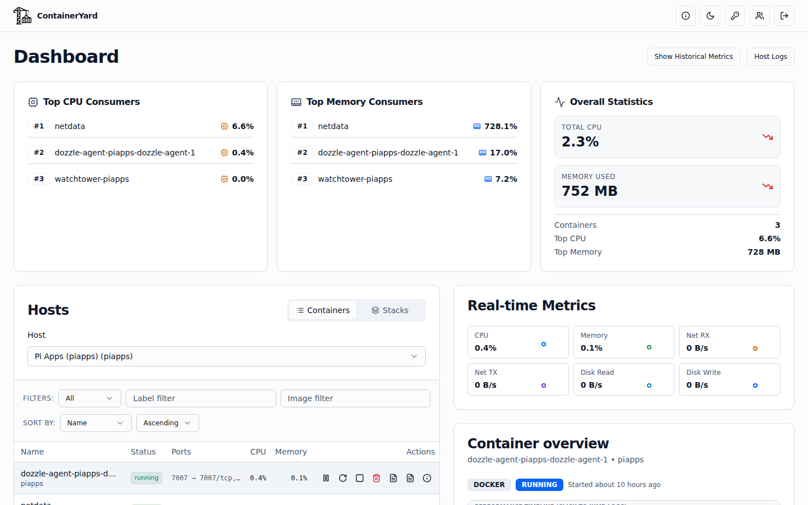
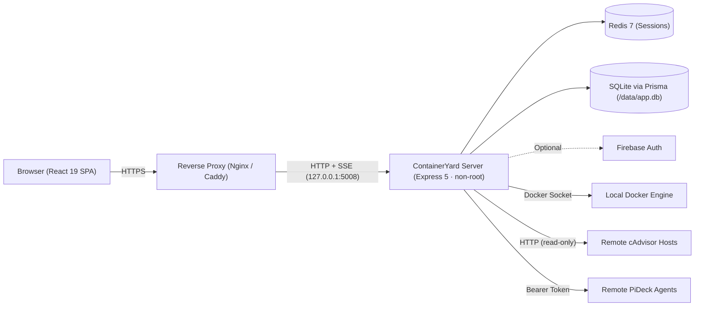

<div align="center">

# ContainerYard 🐳

**Log-first, multi-host Docker observability dashboard with real-time SSE streaming, Compose stack controls, RBAC, and hardened multi-arch images.**

[](https://containeryard.org)
[](https://github.com/hexawulf/ContainerYard/releases/latest)
[](https://hub.docker.com/r/0xwulf/containeryard)
[](https://github.com/hexawulf/ContainerYard/actions/workflows/ci.yml)
[](./LICENSE)

</div>



---

## Why ContainerYard

ContainerYard bridges the gap between bare log viewers and heavyweight monitoring stacks. Deploy it in 30 seconds with `docker compose up -d` to get real-time container logs, Docker Compose stack operations, multi-host cAdvisor/Docker telemetry, RBAC with audit logging, and supply-chain-verified multi-arch (`linux/amd64` + `linux/arm64`) images.

## ✨ Highlights

| Area | Capabilities |
|---|---|
| **Real-Time Log Streaming** | Virtualized SSE log viewer, multi-container interleaving (up to 3), regex & query DSL (`level:warn..error`, `-"exclude"`), JSON field chips, Log Moment bookmarks, saved searches |
| **Compose Stack & Lifecycle Controls** | Automatic Compose project grouping, stack health badges, audited bulk stack & per-container actions (`start`, `stop`, `restart`, `pause`, `unpause`, `remove`) |
| **Multi-Host Observability** | Local Docker Engine + environment-driven remote hosts (`CY_REMOTE_HOSTS`: cAdvisor + optional Dozzle links) and optional remote host logs via PiDeck agents |
| **Security & RBAC** | `ADMIN`/`VIEWER` roles, bcrypt (cost 12), optional Firebase Google Sign-In with email allowlist, instant `sessionVersion` session revocation, CSRF enforcement, SSRF-safe webhooks, full audit log |
| **Supply-Chain Hardening** | Digest-pinned `node:22-bookworm-slim` (no `npm`/`yarn`/`corepack` in runtime), non-root `uid 1000` under `tini`, `read_only` rootfs + `cap_drop: [ALL]`, Trivy CRITICAL gate + SARIF, SBOM & SLSA provenance, weekly security rebuilds |
| **UX & Accessibility** | Light/dark themes (WCAG AA, zero flash on load), responsive desktop & mobile layouts, keyboard shortcuts (`Cmd/Ctrl+K`, `L`, `F`, `Esc`), About diagnostics modal |

> Full version history (v3.0–v6.0) lives in [CHANGELOG.md](./CHANGELOG.md).

---

## 🏗️ Architecture



Deep dive on trust boundaries, runtime layers, and security controls: **[docs/ARCHITECTURE.md](./docs/ARCHITECTURE.md)**.

---

## 🚀 Quick Start (Docker Compose — Recommended)

```bash
git clone https://github.com/hexawulf/ContainerYard.git
cd ContainerYard
cp .env.example .env
# Set SESSION_SECRET, REDIS_PASSWORD, ALLOWED_ORIGINS, ADMIN_EMAIL, ADMIN_PASSWORD, and DOCKER_GID
docker compose up -d
```

- Listens on `127.0.0.1:5008` by default behind your reverse proxy (Nginx / Caddy / Traefik).
- `docker/entrypoint.sh` syncs the Prisma SQLite schema and seeds the bootstrap `ADMIN` user on first boot.
- Pull pre-built multi-arch images directly from Docker Hub: **`0xwulf/containeryard:latest`** (`linux/amd64`, `linux/arm64`).
- Production deployment, volumes, backup/restore, host-logs overlay, and Firebase Auth setup: **[DEPLOYMENT.md](./DEPLOYMENT.md)** and **[docker/README.md](./docker/README.md)**.

### Local Development

```bash
npm ci
cp .env.example .env
npm run db:push:prisma
npm run dev
```

### Verification Commands

```bash
npm run check            # TypeScript (app)
npm run check:tests      # TypeScript (tests)
npm run lint             # ESLint
npm test                 # Unit tests (no Docker or DB required)
npm run test:e2e:ci      # Playwright E2E suite (against live stack)
npm run build            # Production build + dist verification
```

---

## ⚙️ Key Configuration

See [.env.example](./.env.example) for the complete list. Core variables:

| Variable | Description |
|---|---|
| `SESSION_SECRET` | Random 32+ byte secret for session signing |
| `REDIS_URL` / `REDIS_PASSWORD` | Redis session store (bundled in `docker-compose.yml`) |
| `DATABASE_URL` | SQLite path (default `file:/data/app.db`) |
| `CY_LOCAL_HOST_ID` / `CY_LOCAL_HOST_NAME` | Local Docker host identifier & display name |
| `CY_REMOTE_HOSTS` | Optional JSON array of remote cAdvisor / Dozzle hosts |
| `ALLOWED_ORIGINS` | Comma-separated public origin(s) for CORS & CSRF checks |
| `ADMIN_EMAIL` / `ADMIN_PASSWORD` | Bootstrap admin credentials (used only when `User` table is empty) |

---

## 🔑 Keyboard Shortcuts

- `Cmd/Ctrl + K` — Focus search
- `Cmd/Ctrl + L` — Clear logs
- `Cmd/Ctrl + F` — Find in logs
- `Esc` — Close dialogs / clear search

---

## 📚 Documentation

- **[Architecture](./docs/ARCHITECTURE.md)** — Topology, trust boundaries, and security controls
- **[API Reference](./docs/API.md)** — REST, SSE streaming, stack/container actions, RBAC, audit, and Prometheus endpoints
- **[Deployment Guide](./DEPLOYMENT.md)** — Production Docker Compose, reverse proxy, volumes, and operations
- **[Docker Image Guide](./docker/README.md)** — Multi-arch tags, hardening flags, and environment overlays
- **[Security Policy](./SECURITY.md)** — Threat model and vulnerability reporting
- **[Contributing](./CONTRIBUTING.md)** — Dev setup, tests, and PR guidelines
- **[Changelog](./CHANGELOG.md)** — Full release history

---

## 📝 License

Licensed under the [MIT License](./LICENSE). Inspired by [Dozzle](https://dozzle.dev/) and built with [shadcn/ui](https://ui.shadcn.com/).
