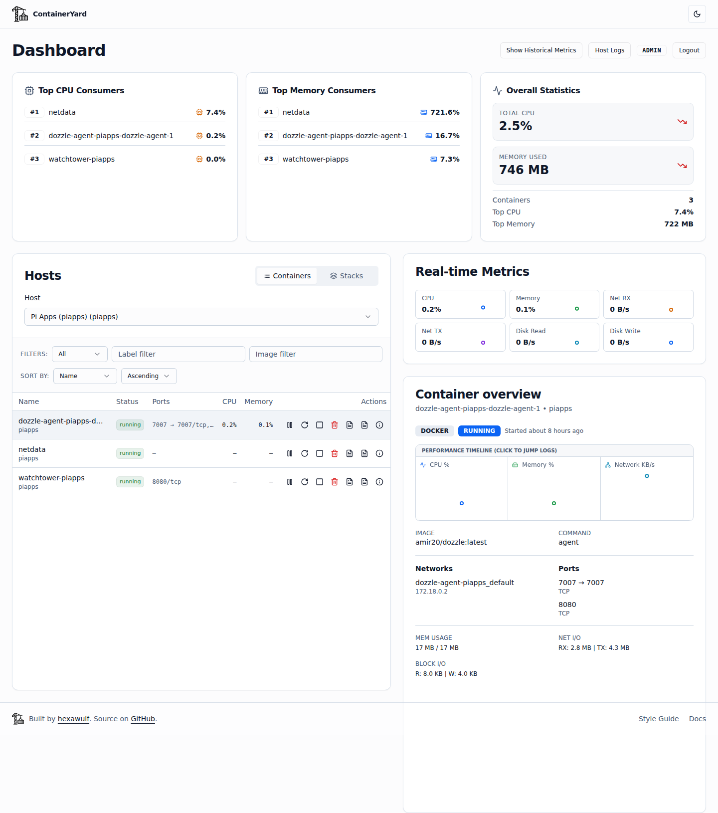
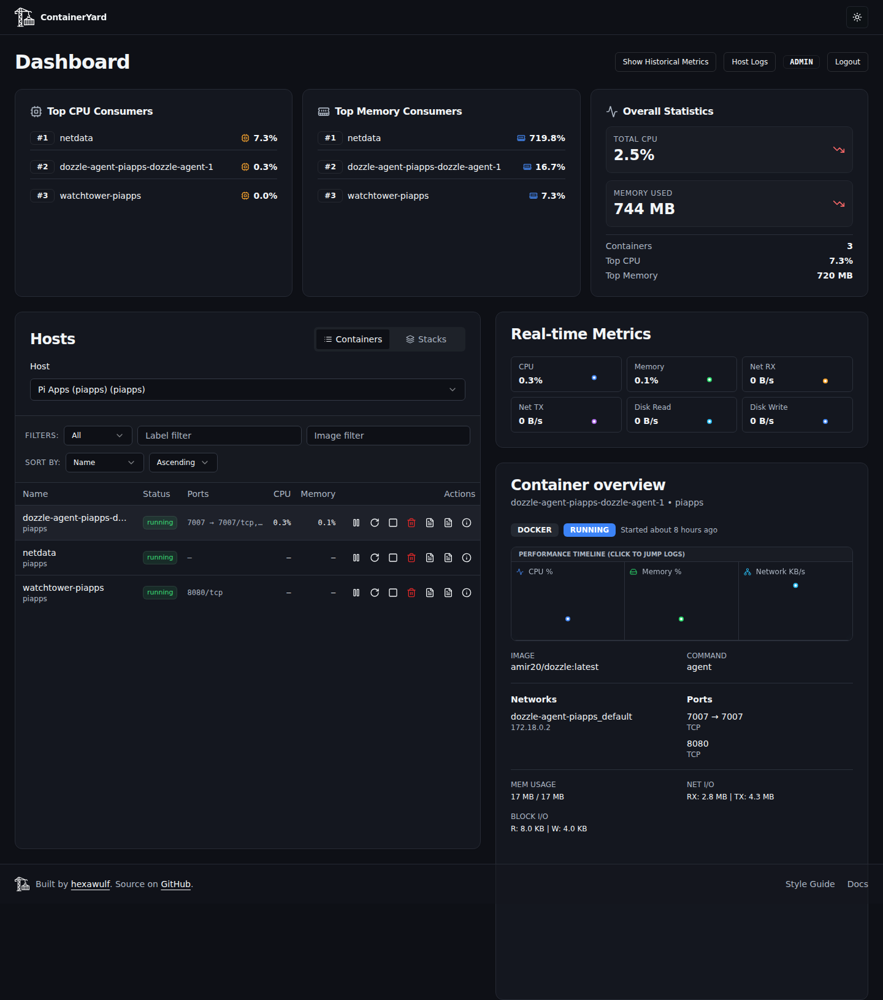
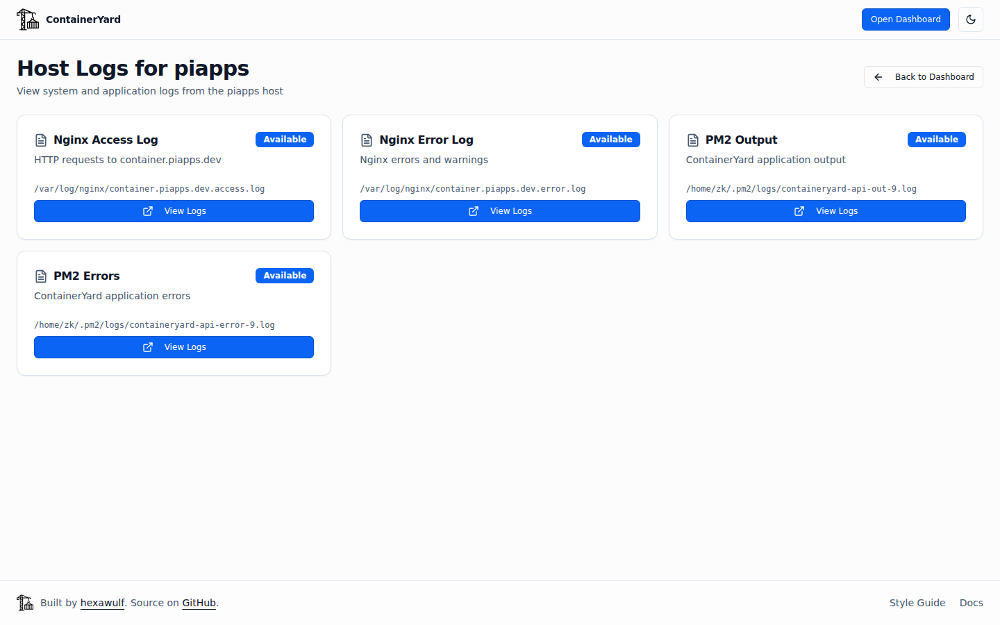
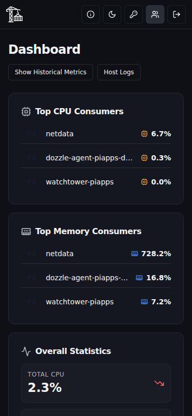
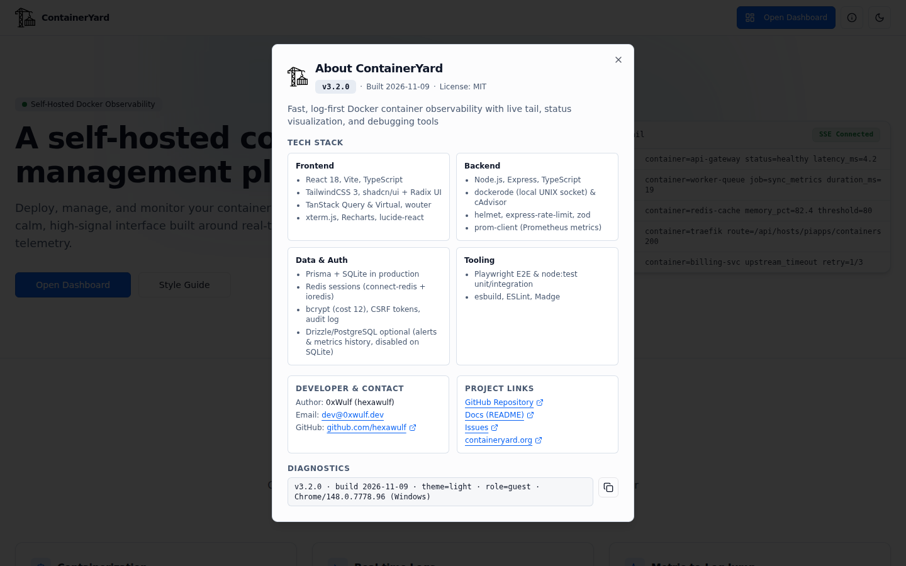
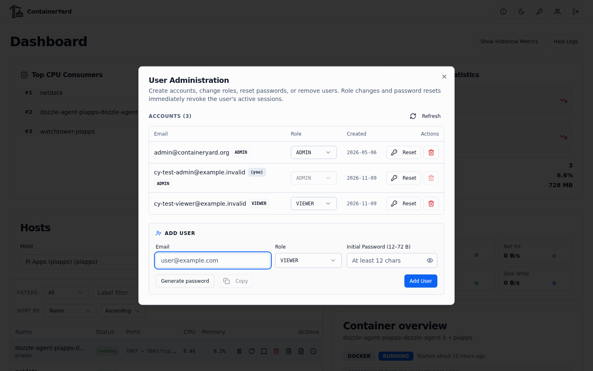

# ContainerYard

**Self-hosted Docker observability dashboard: live logs, stack and container actions, metrics and an audit trail in one fast, light/dark web UI.**

[](https://containeryard.org)
[](https://github.com/hexawulf/ContainerYard)
[](https://github.com/hexawulf/ContainerYard/releases)
[](https://github.com/hexawulf/ContainerYard/blob/main/LICENSE)



ContainerYard sits between a bare log viewer and a full monitoring stack. Point it at your Docker socket and you get a log-first dashboard for every container and Compose stack on the host, plus read-only overviews for remote hosts through cAdvisor.

## Features

- **Real-time logs:** live tail over SSE, virtualized log viewer, `since` / `grep` filtering, Log Moment bookmarks, saved searches, and ADMIN log download.
- **Compose stacks:** automatic grouping by project, health badges, combined stack logs, and ADMIN start/stop/restart actions with confirmation and audit logging.
- **Container actions & inspect:** start, stop, restart, pause, unpause, remove, and raw `docker inspect` for ADMINs only; `VIEWER` role sees `[hidden]` env values.
- **Metrics:** live CPU, memory, and network stats per container and host with short TTL + singleflight caching for sub-5ms dashboard polls.
- **Users and roles:** `ADMIN` / `VIEWER` roles, password policies, instant session revocation (`sessionVersion`) on password reset, role change, or deletion, and full audit log.
- **Security by default:** synchronizer CSRF tokens with `Origin` enforcement, `bcrypt` cost 12, rate limiting, Helmet CSP + security headers, `Secure` Redis sessions, SSRF-safe webhooks, and `read_only: true` non-root (`uid 1000`) container runtime.

| Light | Dark |
| --- | --- |
|  |  |
|  |  |

| About | User administration (ADMIN) |
| --- | --- |
|  |  |

## Tags

| Tag | Meaning |
| --- | --- |
| `5.3.0` | Exact release (recommended for production; pin it) |
| `5.3` | Latest patch of the 5.3 line |
| `latest` | Most recent stable release |

Multi-arch images for **`linux/amd64`** and **`linux/arm64`**, built by GitHub Actions from signed `vX.Y.Z` tags with Trivy scanning, SBOM, and SLSA provenance attestations. See the [changelog](https://github.com/hexawulf/ContainerYard/blob/main/CHANGELOG.md) and full configuration docs in the [README](https://github.com/hexawulf/ContainerYard#configuration).

## Quick start (Docker Compose)

```bash
git clone https://github.com/hexawulf/ContainerYard.git && cd ContainerYard
cp .env.example .env && nano .env
docker compose pull
docker compose up -d
```

- Live demo & docs: **[containeryard.org](https://containeryard.org)**
- Source & issues: **[github.com/hexawulf/ContainerYard](https://github.com/hexawulf/ContainerYard)**
