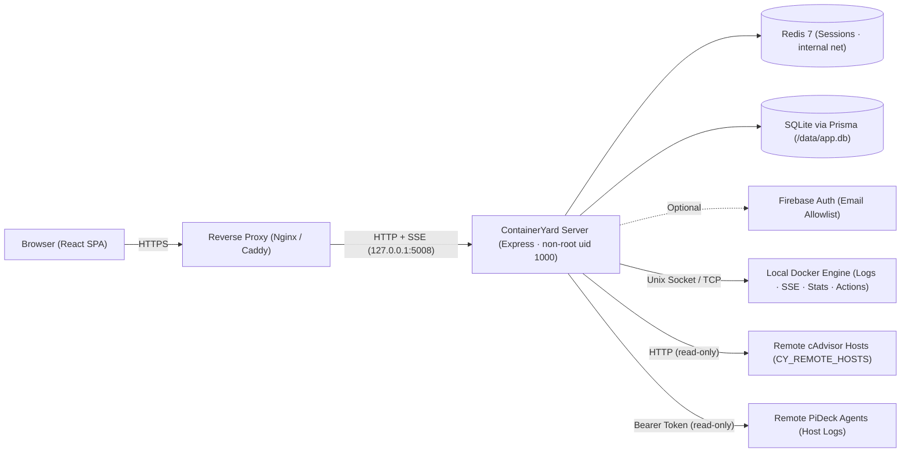

# ContainerYard Architecture

ContainerYard is a self-hosted, multi-host Docker observability platform built as a single TypeScript monorepo (`client/`, `server/`, `shared/`) shipped as a hardened, non-root, multi-arch (`linux/amd64`, `linux/arm64`) Docker image.

## Topology & Trust Boundaries

## Runtime Layers

| Layer | Technology | Responsibility |
|---|---|---|
| **Frontend (`client/`)** | React, TypeScript, Vite, Tailwind CSS, TanStack Query & Virtual, Recharts, Wouter | Real-time dashboard, virtualized log streaming, Compose stack views, RBAC user/password modals, light/dark themes |
| **API & SSE (`server/src/`)** | Node.js 22, Express, `dockerode`, Zod 4, Helmet, `prom-client` | REST API, Server-Sent Events log demuxing (`dockerDemux.ts`), container/stack lifecycle actions, Prometheus `/metrics` |
| **Sessions** | `express-session` + `connect-redis` (Redis 7 AOF on internal network) | Server-side session storage, `SameSite` cookies, instant revocation via `User.sessionVersion` |
| **Persistence** | Prisma + SQLite (`/data/app.db`) | Users, RBAC roles (`ADMIN`/`VIEWER`), `AuditLog`, `LogBookmark`, `SavedSearch` (optional PostgreSQL for legacy Drizzle monitoring tables — unification tracked for v6) |
| **Multi-Host Sources** | Docker Engine API, cAdvisor HTTP, PiDeck Agent API | Local read/write Docker host + remote read-only cAdvisor/Dozzle and host-log nodes |

## Security Controls

- **Authentication & RBAC:** bcrypt (cost 12) password hashing, optional Firebase Google Sign-In with strict email allowlisting, `ADMIN` vs `VIEWER` roles, and `sessionVersion`-based global session revocation on password change or role demotion.
- **CSRF & Headers:** Synchronizer-token CSRF enforcement (`x-csrf-token`) on all mutating routes, Helmet security headers, and strict CSP (`server/src/lib/csp.ts`).
- **SSRF & Input Defense:** Webhook URL validation (`server/src/lib/safeWebhook.ts`) blocks private/loopback/link-local targets; Docker container IDs, log filters, and SSE parameters are strictly validated and rate-limited.
- **Container Hardening:** Multi-stage build on digest-pinned `node:22-bookworm-slim` with `npm`/`yarn`/`corepack` stripped from the runtime image, non-root `node` (`uid 1000`), `tini` PID 1, `read_only: true` rootfs, `cap_drop: [ALL]`, and `no-new-privileges:true`.
- **Supply Chain:** Every release runs CI (typecheck, lint, unit, Docker Compose integration), scans the built image with Trivy (blocking on fixable `CRITICAL` CVEs and uploading SARIF), and publishes `linux/amd64` + `linux/arm64` images with SBOM and SLSA provenance attestations, plus weekly uncached security rebuilds.
